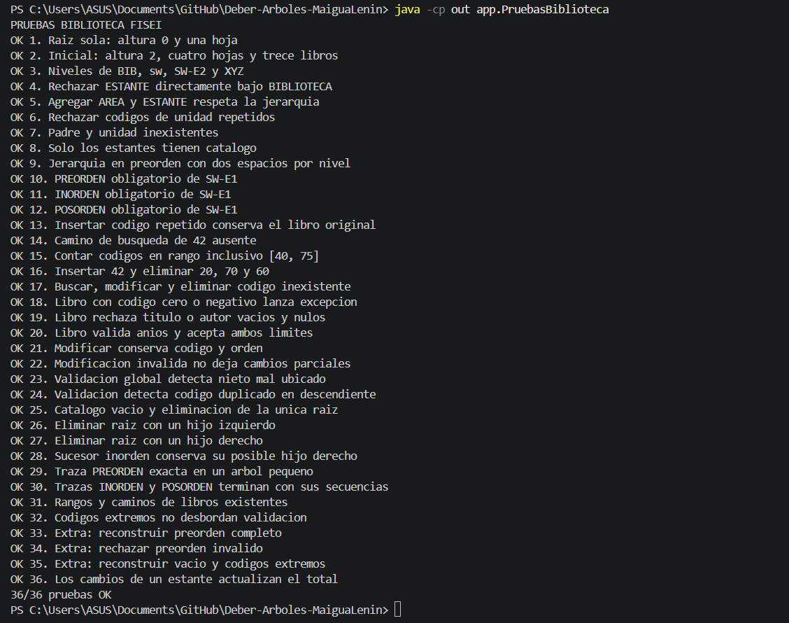

# Catálogo de la Biblioteca FISEI

**Estudiante:** Lenin Alexander Maigua Shigui  
**Curso:** Tercero B  
**Asignatura:** Estructura de Datos

## Descripción del problema

La Biblioteca FISEI se organiza mediante un árbol general:

BIBLIOTECA → AREA → ESTANTE.

Cada estante almacena sus libros en un árbol binario de búsqueda
(ABB), ordenado por códigos enteros positivos y sin repetidos.

La aplicación permite construir, consultar y modificar ambas
estructuras mediante programación orientada a objetos y recursividad.

## Funcionalidades

- Cargar la estructura inicial del deber.
- Agregar y buscar unidades.
- Mostrar la jerarquía de la biblioteca.
- Consultar altura, hojas, niveles y total de libros.
- Insertar, buscar, modificar y eliminar libros.
- Mostrar recorridos en preorden, inorden y posorden con sus trazas.
- Contar libros en un rango, mostrar caminos de búsqueda y validar el ABB.
- Reconstruir un ABB desde su preorden como extra opcional.
- Ejecutar pruebas automáticas.

## Organización del código

```text
src/
├── enums/
│   ├── TipoUnidad.java
│   └── TipoRecorrido.java
├── modelo/
│   ├── Libro.java
│   └── UnidadBiblioteca.java
├── negocio/
│   ├── NodoUnidad.java
│   ├── NodoLibro.java
│   ├── ArbolBiblioteca.java
│   └── CatalogoABB.java
└── app/
    ├── DatosPrueba.java
    ├── PruebasBiblioteca.java
    └── Main.java
```

## Requisitos

- JDK de Java 8 o posterior.
- Comandos `java` y `javac` disponibles.
- PowerShell para ejecutar las instrucciones siguientes.

## Compilar

Abrir una terminal en la carpeta principal del proyecto y ejecutar:

```powershell
New-Item -ItemType Directory -Force -Path out | Out-Null
$fuentes = @(Get-ChildItem -Path src -Recurse -Filter *.java | ForEach-Object { $_.FullName })
javac -encoding UTF-8 -d out $fuentes
```

## Ejecutar el programa

```powershell
java -cp out app.Main
```

Seleccionar la opción 1 y escribir SI para cargar los datos iniciales.
La opción 2 muestra la jerarquía y la opción 0 permite salir.

La biblioteca inicial contiene 7 unidades, altura 2, cuatro hojas
y 13 libros.

Los títulos y autores iniciales son datos de prueba, porque el
enunciado únicamente proporciona los códigos de los libros.

## Ejecutar las pruebas

```powershell
java -cp out app.PruebasBiblioteca
```

Se ejecutan 36 casos que comprueban la jerarquía, las validaciones,
los recorridos, las trazas, las eliminaciones y los retos.

Resultado obtenido:

```text
36/36 pruebas OK
```

## Captura de las pruebas



## Trazas personales

Los cálculos del ABB personalizado, sus recorridos y las
eliminaciones se documentan en [TRAZAS.md](TRAZAS.md).