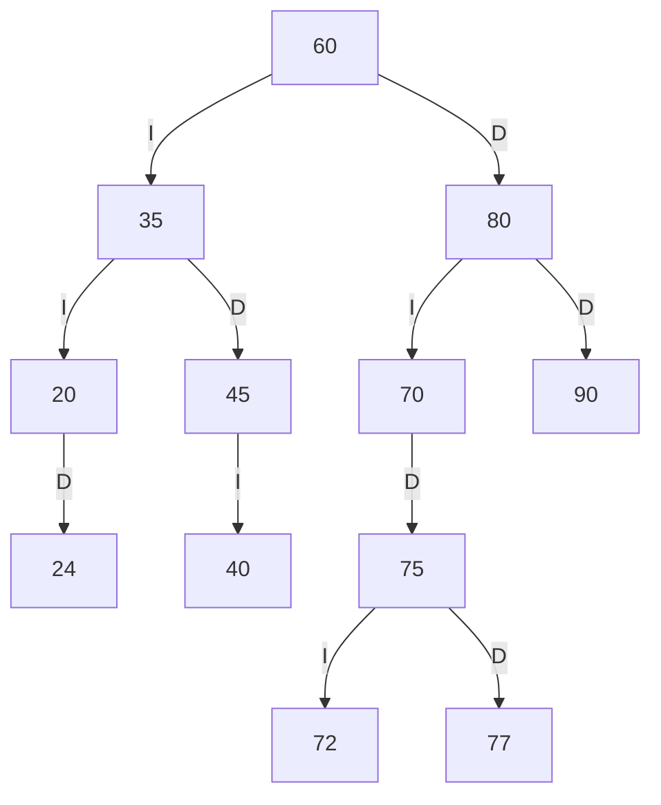
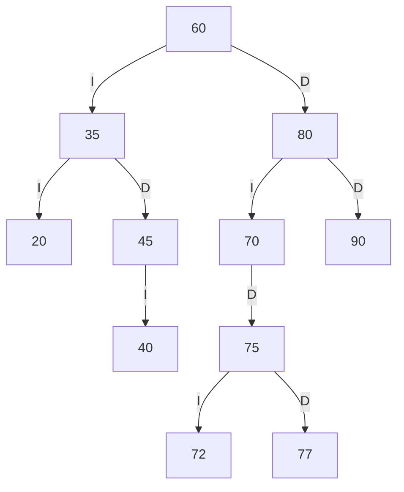
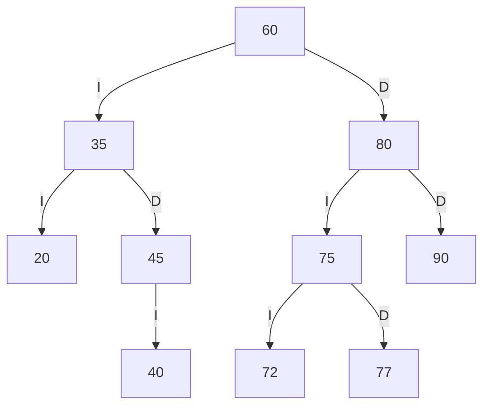
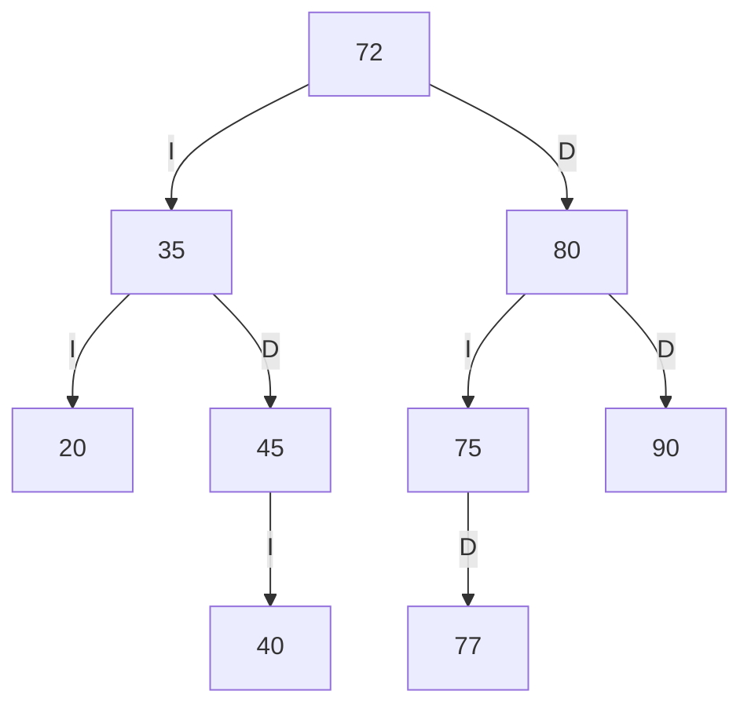

# Trazas personales del ABB de SW-E1

**Estudiante:** Lenin Alexander Maigua Shigui

## 1. Códigos personales

Los últimos cuatro dígitos utilizados son **7724**.

| Formación | Código |
|---|---:|
| ab | 77 |
| bc | 72 |
| cd | 24 |

No se requieren ajustes: los tres códigos son positivos,
diferentes y no existen en el ABB inicial de SW-E1.

## 2. Inserciones

Primero se insertan los códigos del enunciado en este orden:

```text
60 35 80 20 45 70 90 40 75
```

Después se insertan los códigos personales:

```text
77 72 24
```

| Código | Camino de comparación | Ubicación nueva |
|---:|---|---|
| 77 | 60 → 80 → 70 → 75 | Hijo derecho de 75 |
| 72 | 60 → 80 → 70 → 75 | Hijo izquierdo de 75 |
| 24 | 60 → 35 → 20 | Hijo derecho de 20 |

Salida relevante del programa tras insertar los tres libros
y consultar SW-E1:

```text
Libro insertado.
Libro insertado.
Libro insertado.
Libros del estante: 12
```

**Comparación:** coinciden las tres inserciones y el total
de 12 libros.

## 3. ABB personalizado resultante

Las aristas I y D indican hijo izquierdo y derecho,
respectivamente.



## 4. Tres recorridos

Recorridos calculados:

```text
PREORDEN: 60 35 20 24 45 40 80 70 75 72 77 90
INORDEN: 20 24 35 40 45 60 70 72 75 77 80 90
POSORDEN: 24 20 40 45 35 72 77 75 70 90 80 60
```

La opción 10 del programa, seleccionando SW-E1, muestra estas
líneas para PREORDEN, INORDEN y POSORDEN, respectivamente:

```text
Codigos: 60 35 20 24 45 40 80 70 75 72 77 90
Codigos: 20 24 35 40 45 60 70 72 75 77 80 90
Codigos: 24 20 40 45 35 72 77 75 70 90 80 60
```

**Comparación:** los tres recorridos coinciden con los cálculos.

## 5. Traza del preorden

La raíz tiene nivel 0. Se utilizan dos espacios por nivel.

```text
entra 60
VISITA 60
  entra 35
  VISITA 35
    entra 20
    VISITA 20
      null -> regresa
      entra 24
      VISITA 24
        null -> regresa
        null -> regresa
    entra 45
    VISITA 45
      entra 40
      VISITA 40
        null -> regresa
        null -> regresa
      null -> regresa
  entra 80
  VISITA 80
    entra 70
    VISITA 70
      null -> regresa
      entra 75
      VISITA 75
        entra 72
        VISITA 72
          null -> regresa
          null -> regresa
        entra 77
        VISITA 77
          null -> regresa
          null -> regresa
    entra 90
    VISITA 90
      null -> regresa
      null -> regresa
Secuencia PREORDEN: 60 35 20 24 45 40 80 70 75 72 77 90
```

**Comparación:** la traza del programa coincide con el cálculo,
incluidos los eventos entra, VISITA, los hijos null y la secuencia final.

## 6. Eliminaciones sucesivas

Las tres eliminaciones se realizan sobre el árbol personalizado
anterior, sin volver a cargar la estructura inicial entre operaciones.

### 6.1. Eliminar 24: hoja

El nodo 24 no tiene hijos. Se elimina el enlace derecho de 20.



Preorden calculado:

```text
60 35 20 45 40 80 70 75 72 77 90
```

Salida relevante del programa:

```text
Libro eliminado.
Libros del estante: 11
Codigos: 60 35 20 45 40 80 70 75 72 77 90
```

**Comparación:** coincide con el árbol y el preorden calculados.

### 6.2. Eliminar 70: un hijo

El nodo 70 tiene un único hijo: 75. El nodo 75 pasa a ser hijo
izquierdo de 80, conservando sus hijos 72 y 77.



Preorden calculado:

```text
60 35 20 45 40 80 75 72 77 90
```

Salida relevante del programa:

```text
Libro eliminado.
Libros del estante: 10
Codigos: 60 35 20 45 40 80 75 72 77 90
```

**Comparación:** coincide con el árbol y el preorden calculados.

### 6.3. Eliminar 60: dos hijos

El nodo 60 tiene dos hijos. Su sucesor inorden es 72, el menor
código del subárbol derecho.

El libro 72 ocupa la raíz y se elimina su ubicación anterior
como hijo izquierdo de 75.



Preorden calculado:

```text
72 35 20 45 40 80 75 77 90
```

Salida relevante del programa:

```text
Libro eliminado.
Libros del estante: 9
Codigos: 72 35 20 45 40 80 75 77 90
```

**Comparación:** coincide con el árbol y el preorden calculados.

## 7. Resumen de comprobación

| Comprobación | Resultado |
|---|---|
| Inserción de 77, 72 y 24 | Coincide; 12 libros |
| Preorden | Coincide |
| Inorden | Coincide |
| Posorden | Coincide |
| Traza del preorden | Coincide |
| Eliminar 24, hoja | Coincide; 11 libros |
| Eliminar 70, un hijo | Coincide; 10 libros |
| Eliminar 60, dos hijos | Coincide; 9 libros y raíz 72 |

## 8. Reproducir en el menú

1. Ejecutar `java -cp out app.Main`.
2. Elegir 1 y escribir SI para cargar la estructura inicial.
3. Usar la opción 6 tres veces para insertar 77, 72 y 24 en SW-E1.
   Introducir título y autor no vacíos y año 2026.
4. Usar la opción 4 con SW-E1 para consultar la cantidad de libros.
5. Usar la opción 10 con SW-E1 y seleccionar 1, 2 y 3 para obtener
   los tres recorridos y sus trazas.
6. Usar la opción 9 para eliminar 24. Consultar SW-E1 y mostrar su preorden.
7. Repetir el paso anterior para eliminar 70 y después 60.
8. Elegir 0 para salir.